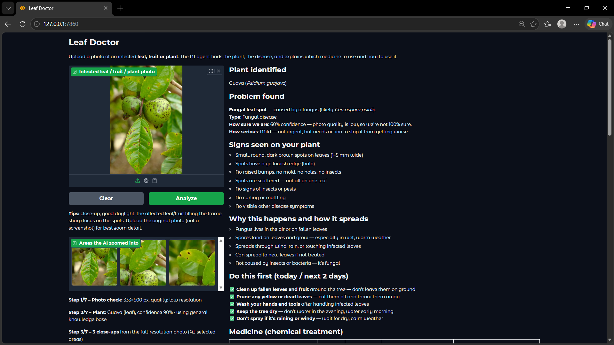
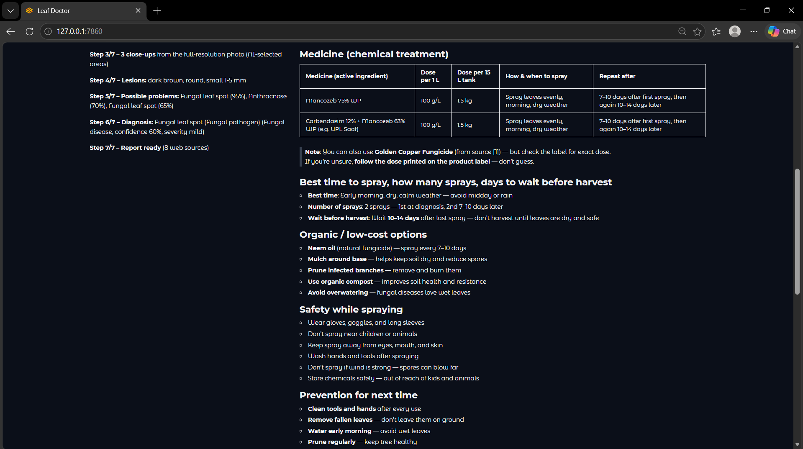

# Leaf Doctor

Leaf Doctor is an AI-powered plant health assistant. Upload a photo of a leaf, fruit, or plant to review visible symptoms, identify possible plant diseases, and receive practical treatment guidance. The app uses Streamlit for its interface and Ollama to run the vision model locally.

> AI results are suggestions based on the uploaded photo. Confirm diagnoses and chemical treatments with a local agriculture officer or KVK, and always follow the product label.

## Features

- Upload a plant photo or take one with your camera.
- Check image quality and identify the plant.
- Zoom in on affected areas and review visible symptoms.
- Compare possible diseases with the crop knowledge base.
- Generate a farmer-friendly report with treatment guidance and web sources.

## Screenshots

### Diagnosis



### Treatment report



## Run with Docker

### Requirements

- Docker Desktop installed and running.
- Internet connection for the first startup. Docker images and the Ollama model will be downloaded; the model may require several GB of storage.

### Start

Open PowerShell in the project folder and run:

```powershell
docker compose up --build
```

When Streamlit is ready, open **http://localhost:8501**. Keep the terminal open while using the app. Press **Ctrl+C** to stop it.

To run in the background:

```powershell
docker compose up --build -d
```

To stop the background services:

```powershell
docker compose down
```

The Ollama model is stored in a Docker volume and is kept when you stop or rebuild the app. To also delete the saved model data:

```powershell
docker compose down -v
```

### Select a model (optional)

The default vision model is `qwen3-vl:4b-instruct`. To set a different model, create a `.env` file in the project folder:

```dotenv
VISION_MODEL=qwen3-vl:4b-instruct
FALLBACK_MODELS="qwen3-vl:4b gemma3:4b"
```

The model service tries `VISION_MODEL` first, then tries the fallback models in order.

## Run locally without Docker

1. Install Python 3.11 and Ollama.
2. Open PowerShell in the project folder.
3. Install the Python packages:

   ```powershell
   python -m pip install -r requirements.txt
   ```

4. Start the app:

   ```powershell
   python app.py
   ```

5. Open **http://127.0.0.1:8501** in your browser.

On first launch, the app downloads a configured model if it is not already installed. Local Ollama model files are stored in the project's `models` folder.

## How the analysis works

1. Checks photo sharpness, brightness, and resolution.
2. Identifies the plant and selects affected regions.
3. Creates close-up crops from the original photo.
4. Describes visible symptoms such as spot colour, shape, and texture.
5. Compares those signs with crop-specific information in `kb.py`.
6. Verifies the leading diagnosis and estimates confidence.
7. Searches for treatment information and generates a report.

## Project files

- `app.py` — Streamlit interface and Ollama startup.
- `agent.py` — image processing, diagnosis workflow, research, and report generation.
- `kb.py` — crop and disease knowledge base.
- `config.py` — model and image settings.
- `Dockerfile` and `compose.yaml` — Docker build and services.
- `requirements.txt` — Python dependencies.

You can add crop and disease entries to `kb.py` to improve regional coverage.
